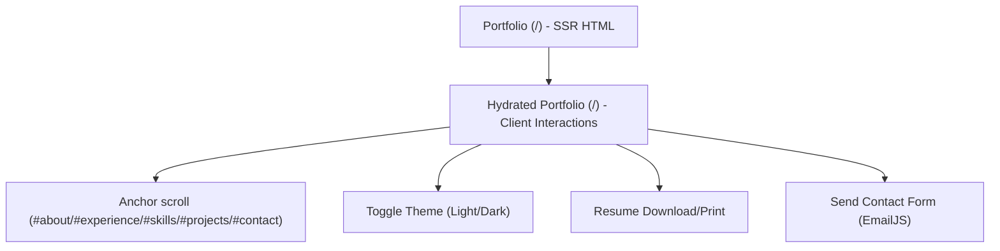

## 1. Product Overview

Upgrade your existing single-page React portfolio to Server-Side Rendering (SSR) while preserving the current UI, section-based navigation, and behaviors.
Primary goals: improve SEO/social previews, faster first paint, and maintain identical look-and-feel after hydration.

## 2. Core Features

### 2.1 Feature Module

This portfolio requirements consist of the following main pages:

1. **Portfolio (Single Page)**: navbar with section links, hero, about, experience, skills, projects, contact, footer.

### 2.2 Page Details

| Page Name               | Module Name        | Feature description                                                                                                      |
| ----------------------- | ------------------ | ------------------------------------------------------------------------------------------------------------------------ |
| Portfolio (Single Page) | SSR delivery       | Render initial HTML on the server and hydrate on the client, keeping UI identical after hydration.                       |
| Portfolio (Single Page) | Section navigation | Scroll to sections via navbar links (`#about`, `#experience`, `#skills`, `#projects`, `#contact`) with smooth scrolling. |
| Portfolio (Single Page) | Theme toggle       | Toggle dark/light mode and persist preference in localStorage (with safe SSR behavior).                                  |
| Portfolio (Single Page) | Hero section       | Present name/role and primary introduction content.                                                                      |
| Portfolio (Single Page) | About section      | Present personal summary and key highlights.                                                                             |
| Portfolio (Single Page) | Experience section | Present work experience timeline/cards.                                                                                  |
| Portfolio (Single Page) | Skills section     | Present skills list/categories.                                                                                          |
| Portfolio (Single Page) | Projects section   | Present project cards with images and key details.                                                                       |
| Portfolio (Single Page) | Contact section    | Send message via EmailJS form; show validation, loading, success, and error states.                                      |
| Portfolio (Single Page) | Resume download    | Trigger resume printing/downloading via existing print workflow.                                                         |
| Portfolio (Single Page) | Footer             | Show footer content and links.                                                                                           |

## 3. Core Process

**Visitor Flow**

1. You open the portfolio at `/` and see server-rendered content immediately.
2. After hydration, you can:

   * Click navbar links to smooth-scroll to sections.

   * Toggle dark mode (preference persists).

   * Open/print/download the resume.

   * Submit the contact form and see success/error feedback.

