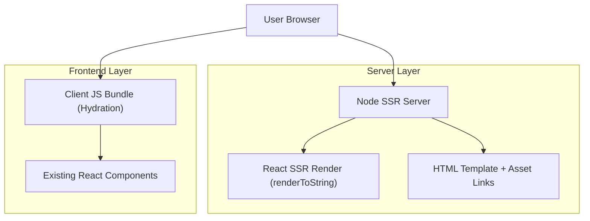

## 1.Architecture design

## 2.Technology Description
- Frontend: React@19 + tailwindcss@4 + framer-motion + lucide-react + Vite@6 (client bundle)
- Backend: Node.js + Express@4 (SSR HTTP server) + Vite SSR runtime (dev middleware + SSR build)

## 3.Route definitions
| Route | Purpose |
|---|---|
| / | Render the portfolio page via SSR and hydrate the same UI client-side |

## 6.Data model(if applicable)
Not applicable (no database).

---

## 7. Migration Steps (preserve UI + “routes”)
1. **Introduce SSR entry points**
   - Create `entry-client.jsx` to hydrate into `#root`.
   - Create `entry-server.jsx` to export `render(url)` that returns `{ html, head }`.
2. **Add an SSR server**
   - Add `server.js` (Express).
   - Dev mode: mount Vite middleware and call `vite.ssrLoadModule()`.
   - Prod mode: serve `dist/client` static assets and use `dist/server` SSR bundle.
3. **Convert current `index.html` into an SSR template**
   - Keep existing `<title>`, fonts, and base body classes.
   - Replace `

` with `<!--app-html-->` placeholder.
4. **Ensure SSR-safe code paths (no DOM at module scope)**
   - Keep all `window/document/localStorage` usage inside effects or event handlers.
   - If any library touches DOM at import-time, switch to lazy import on client.
5. **Theme (dark mode) hydration alignment**
   - Add a tiny inline script in the HTML template to set `document.documentElement.classList` from `localStorage` before hydration to avoid flicker/mismatch.
6. **Verify anchor navigation behavior**
   - Keep the “route” as `/` and preserve section anchors (`#about`, etc.).
   - Ensure smooth scrolling runs only in the browser.
7. **Build & scripts updates**
   - Add `build:ssr` to produce both client and server bundles.
   - Add `start` to run the production SSR server.

## 8. Key Risks & Mitigations
| Risk | Why it happens in SSR | Mitigation |
|---|---|---|
| Hydration mismatch / theme flicker | Server can’t read `localStorage` | Inline pre-hydration theme script; default consistent server theme. |
| Libraries not SSR-safe | Some packages access DOM during import | Lazy import on client (e.g., inside click handlers/effects) or conditional `if (import.meta.env.SSR)` guards. |
| EmailJS bundling/runtime issues | SDK may assume browser APIs | Use dynamic import inside `handleSubmit` if needed; keep form usable after hydration. |
| Animation/layout effect warnings | Motion libs may use layout effects | Prefer SSR-friendly motion patterns; accept no-op on server; test in prod build. |
| Asset path issues | SSR server must serve `public/`-built assets | Ensure Vite asset handling and static serving is correct in prod mode. |
